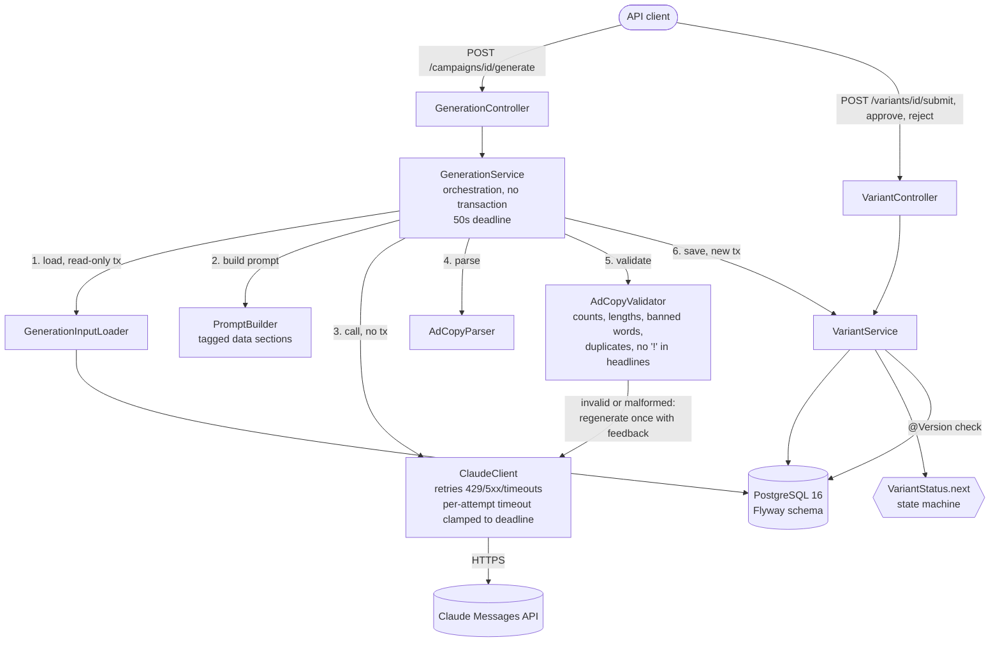
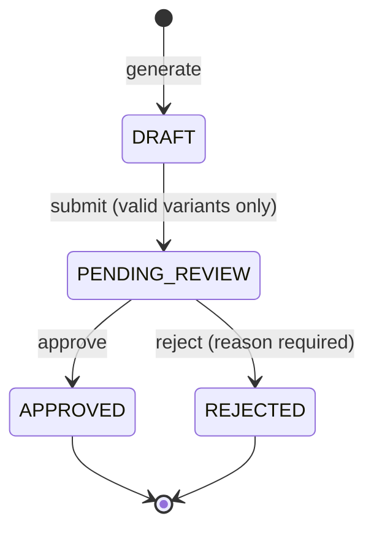

# FranchiseAds

A Spring Boot service that writes localized Google Ads copy for every location of a franchise brand with the Claude API. It checks every word the model writes against deterministic rules, and only copy that passes can go to human review.

## Overview

A franchise brand runs the same campaign in dozens or hundreds of locations. Each location has its own city, region and local offer ("Free first class in Austin"), so each needs its own responsive search ads. Writing them by hand doesn't scale, and copying one ad everywhere loses the local angle.

A language model writes good local copy in seconds, but its output can't be trusted as is. It overshoots Google's character limits (30 per headline, 90 per description), uses words the brand has banned, repeats itself, and sometimes doesn't answer in the requested format at all.

FranchiseAds puts a deterministic validator between the model and the review queue:
1. A generate request builds a prompt from the brand's voice and banned words, the location and the campaign theme, then calls Claude.
2. The answer is parsed and checked against every rule. A failing answer gets exactly one regeneration, with the violations fed back to the model.
3. If it still fails, the variant is saved **flagged**, with every violation listed, and it can never be submitted.
4. Valid variants move through an approval workflow: `DRAFT` → `PENDING_REVIEW` → `APPROVED` or `REJECTED`.

Every request has a 50-second bound on the Claude phase, and database transactions are never held open across a model call. Errors are RFC 9457 problem details throughout.

## Architecture





The code is packaged by feature (`brand`, `location`, `campaign`, `generation`, `claude`, `validation`, `variant`, `common`). Controllers are thin, DTOs are records, and only Flyway changes the schema. The full behavioral spec, including the outcome table for every combination of call results, is in [docs/flow.md](docs/flow.md).

## API

| Method | Path | Purpose |
|---|---|---|
| `POST` | `/brands` | Create a brand with its voice guidelines and banned words |
| `GET` | `/brands` | List all brands |
| `GET` | `/brands/{id}` | Get a brand |
| `POST` | `/brands/{brandId}/locations` | Add a location (city, region, local offer) to a brand |
| `GET` | `/brands/{brandId}/locations` | List a brand's locations |
| `GET` | `/locations/{id}` | Get a location |
| `POST` | `/brands/{brandId}/campaigns` | Add a campaign (theme) to a brand |
| `GET` | `/brands/{brandId}/campaigns` | List a brand's campaigns |
| `GET` | `/campaigns/{id}` | Get a campaign |
| `POST` | `/campaigns/{campaignId}/generate` | Generate, validate and save ad copy for one location (`{"locationId": 1}`) |
| `GET` | `/campaigns/{campaignId}/variants` | List a campaign's variants, optionally `?status=DRAFT` and so on |
| `GET` | `/variants/{id}` | Get a variant |
| `POST` | `/variants/{id}/submit` | Submit a valid `DRAFT` variant for review |
| `POST` | `/variants/{id}/approve` | Approve a variant pending review |
| `POST` | `/variants/{id}/reject` | Reject a variant pending review (`{"reason": "..."}`) |

With the app running, Swagger UI is at **http://localhost:8080/swagger-ui.html** and the OpenAPI document at http://localhost:8080/v3/api-docs. Every operation lists its success response and the problem-detail errors it can return (400, 404, 409, 422, 502, 503, 504), as specified in [docs/flow.md](docs/flow.md#error-mapping). `GET /actuator/health` reports liveness.

## Running it

Prerequisites: Docker. For the Maven-based options, also JDK 21 with `JAVA_HOME` pointing at it.

Generation needs a Claude API key; everything else works without one. Put the key in a `.env` file in the repo root, which is git-ignored and never copied into the image:

```bash
cp .env.example .env              # PowerShell: Copy-Item .env.example .env
# then edit .env: ANTHROPIC_API_KEY=...
```

Without a key, the app starts normally and generate answers 502 "The AI provider rejected the request."

### 1. Full stack in Docker (app + Postgres)

Needs only Docker. Builds the image and starts the app once Postgres is healthy.

PowerShell:

```powershell
docker compose --profile app up -d --build
curl.exe http://localhost:8080/actuator/health
start http://localhost:8080/swagger-ui.html
docker compose --profile app down
```

Linux:

```bash
docker compose --profile app up -d --build
curl http://localhost:8080/actuator/health
xdg-open http://localhost:8080/swagger-ui.html
docker compose --profile app down
```

The health check answers `{"groups":["liveness","readiness"],"status":"UP"}` once the app is up, which takes a few seconds after `up` returns. Stop with `--profile app down`: plain `docker compose down` leaves the app container running. Port 8080 must be free, so stop any `spring-boot:run` first.

### 2. App on the host with Maven, Postgres in Docker

Plain `docker compose up -d` starts only Postgres, on `localhost:5432`.

PowerShell:

```powershell
docker compose up -d
.\mvnw.cmd spring-boot:run
# in a second terminal:
curl.exe http://localhost:8080/actuator/health
```

Linux:

```bash
docker compose up -d
./mvnw spring-boot:run
# in a second terminal:
curl http://localhost:8080/actuator/health
```

Stop the app with Ctrl+C and Postgres with `docker compose down` (add `-v` to delete the data volume too). `.\mvnw.cmd spring-boot:test-run` (`./mvnw spring-boot:test-run` on Linux) runs the app against a throwaway Testcontainers Postgres instead, with no compose needed.

### 3. Tests

Docker must be running; no API key is needed and none is used.

```powershell
.\mvnw.cmd verify
```

```bash
./mvnw verify
```

One class: `.\mvnw.cmd test -Dtest=AdCopyValidatorTests` (on Linux, `./mvnw test -Dtest=AdCopyValidatorTests`).

## Configuration

Everything comes from environment variables, and a `.env` in the working directory is read too, for local runs. Real environment variables win over `.env`, and `.env` is parsed as a `.properties` file, so write `KEY=value` lines without quotes.

| Variable | Default | What it does |
|---|---|---|
| `DB_URL` | `jdbc:postgresql://localhost:5432/franchiseads` | JDBC URL. The compose `app` service sets its own (`postgres:5432`) and ignores this. |
| `DB_USERNAME` | `franchiseads` | Database user. Compose's Postgres uses it too, but only when the volume is first created (after a change, run `docker compose down -v`). |
| `DB_PASSWORD` | `franchiseads` | Database password, same rule as `DB_USERNAME`. |
| `ANTHROPIC_API_KEY` | empty | Claude API key. Empty: the app runs, generate answers 502. |
| `ANTHROPIC_MODEL` | `claude-haiku-5-5` | Model ID sent with every request. |
| `ANTHROPIC_EFFORT` | `low` | Sent as `output_config.effort` (`low`, `medium`, `high`, `xhigh`, `max`). `none` leaves the field out, for models without effort support such as Haiku 4.5. |
| `API_DOCS_ENABLED` | `true` | `false` turns off `/v3/api-docs` and Swagger UI (both then 404). |
| `JAVA_TOOL_OPTIONS` | `-XX:MaxRAMPercentage=75.0 -XX:+ExitOnOutOfMemoryError` | Docker image only: JVM flags. The heap is sized from the container's memory limit. |

The tuning knobs have defaults in code and are rarely changed. Each can be set through Spring's relaxed binding, for example `FRANCHISEADS_CLAUDE_MAXATTEMPTS=5` for `franchiseads.claude.max-attempts`. Out-of-range values stop startup with a message naming the property.

| Variable | Default | What it does |
|---|---|---|
| `FRANCHISEADS_GENERATION_DEADLINE` | `50s` | Time budget for the whole Claude phase of one generate request, retries and regeneration included |
| `FRANCHISEADS_CLAUDE_READTIMEOUT` | `20s` | Per-attempt timeout (connect included), clamped to the deadline |
| `FRANCHISEADS_CLAUDE_CONNECTTIMEOUT` | `3s` | TCP connect timeout |
| `FRANCHISEADS_CLAUDE_MAXATTEMPTS` | `3` | Attempts per model call, retries included (1 to 10) |
| `FRANCHISEADS_CLAUDE_INITIALBACKOFF` | `500ms` | First retry delay; doubles each retry, with up to 25% jitter |
| `FRANCHISEADS_CLAUDE_RETRYAFTERCAP` | `10s` | Cap on a delay requested by `retry-after` |
| `FRANCHISEADS_CLAUDE_MAXTOKENS` | `4096` | `max_tokens` per request |
| `FRANCHISEADS_CLAUDE_BASEURL` | `https://api.anthropic.com` | API base URL (tests point it at WireMock) |
| `FRANCHISEADS_ADCOPY_HEADLINECOUNT` | `5` | Headlines per variant (3 to 15, Google's limits) |
| `FRANCHISEADS_ADCOPY_DESCRIPTIONCOUNT` | `2` | Descriptions per variant (2 to 4) |

## Testing

`./mvnw verify` runs 344 tests in 34 classes, on every push in CI (GitHub Actions, Linux, no API key). A second CI job builds the Docker image.

| Layer | How | Examples |
|---|---|---|
| Pure logic | Plain JUnit, no Spring | `AdCopyValidatorTests` (one test per rule, 30 vs 31 characters, emoji counted as one), `VariantStatusTests` (all 24 status × action × flag combinations), `PromptBuilderTests`, `AdCopyParserTests` |
| Services | Mockito | `GenerationServiceTests`: every row of the generate outcome table, with the real parser and validator |
| Web slice | `@WebMvcTest` + MockMvc | One class per controller: status codes, validation errors, problem-detail bodies |
| HTTP client | WireMock (standalone, shaded) | `ClaudeClientTests`: retries, `retry-after`, timeouts, the deadline clamp, the request headers and body WireMock received. Backoff goes through an injectable sleeper, so nothing really sleeps. |
| Persistence | Testcontainers `postgres:16` | Flyway migration + `ddl-auto: validate`, a round trip for every `text[]` column, the unique index |
| Integration | Full app over HTTP on Postgres | `*ApiIntegrationTests`, transaction boundaries (no transaction open during a Claude call), optimistic locking, API docs coverage |
| End to end | Real `ClaudeClient` against WireMock, real Postgres | `ApprovalWorkflowEndToEndTests`: create brand, location, campaign; generate; submit; approve |
| Live (excluded) | `@Tag("live")`, one real API call | `ClaudeLiveSmokeTests`, run by hand with `./mvnw test -Plive` and a key. Never in `verify` or CI. |

Integration tests truncate every table before each test (`TruncateTablesExtension`), so each starts with empty tables and IDs from 1.

**Proving each test can fail.** A green test that would also be green with the code broken proves nothing. So the tests that guard a property are checked by deliberately breaking that property and watching them fail, then restoring it:
- `GenerationTransactionBoundaryTests` failed with `@Transactional` added to `generate`.
- `VariantOptimisticLockingTests` failed with the `@Version` check removed: the stale reject returned 200 and landed.
- `TruncateTablesExtensionTests` failed without the extension.
- `OpenApiDocumentationTests` failed on each of these: a hidden endpoint, a missing summary, a dropped error status, a missing 201.

Each check is recorded in [docs/progress.md](docs/progress.md) and the ADRs.

## Design decisions

The full list, with the alternatives considered, is in [docs/decisions.md](docs/decisions.md). The most important:

- **[The validator decides, not the model](docs/decisions.md#adr-010-the-validator-is-the-source-of-truth-not-the-model) (ADR-010).** The prompt states the rules, but only a deterministic `AdCopyValidator` decides whether copy can reach review.
- **[Regenerate once, then flag](docs/decisions.md#adr-011-regenerate-once-then-flag) (ADR-011).** At most two model calls per request. Copy that still fails is saved with its violations for a human to see, never silently retried.
- **[No database transaction across a Claude call](docs/decisions.md#adr-029-transaction-boundaries-through-separate-beans-proven-by-a-test) (ADR-012, ADR-029).** Load in a read-only transaction, call Claude with none, save in a new one. A test fails if anyone adds `@Transactional` to the orchestration.
- **[Retry the transport, not the model](docs/decisions.md#adr-022-retry-transport-failures-only-the-envelope-vs-model-output-boundary) (ADR-022).** 429, 5xx, timeouts and broken responses are retried inside the client. A well-formed response with bad copy is handed to the single regeneration instead, so retries never multiply model calls.
- **[A 50s deadline per request](docs/decisions.md#adr-027-read-timeout-20s-and-a-50s-per-request-deadline) (ADR-027).** Shared by both calls and all retries, with each attempt's timeout clamped to the time left.
- **[Save the last parseable attempt](docs/decisions.md#adr-030-save-the-last-parseable-attempt-fail-only-when-there-is-none) (ADR-030).** A request never returns an error while it holds usable copy. It fails (502/503/504) only when no call produced parseable output.
- **[One state machine, plus optimistic locking](docs/decisions.md#adr-032-variantstatusnext-holds-every-transition-rule-repeated-actions-are-409) (ADR-032, [ADR-033](docs/decisions.md#adr-033-version-optimistic-locking-on-review-actions-etagif-match-rejected)).** `VariantStatus.next` holds every transition rule; illegal and repeated actions are 409. `@Version` makes concurrent approve/reject safe: the first commit wins, the other gets 409.

## Measured results

**Effort setting** ([ADR-026](docs/decisions.md#adr-026-send-output_configeffort-default-low-never-send-thinking)). The default model, `claude-haiku-5-5`, thinks at effort `medium` unless told otherwise, and thinking is billed as output. The same brief and prompt, one live run each:

| Run | Effort sent | Latency | Input tokens | Output tokens | Thinking tokens |
|---|---|---|---|---|---|
| Before | none (model default `medium`) | 3632 ms | 652 | 624 | not logged (1 thinking block) |
| After | `low` | 1817 ms | 652 | 133 | 0 |

Output tokens fell by 79%, and the copy was valid in both runs. These are single runs, so the latency numbers are indicative; the token counts are the reliable comparison.

**Latency budget** ([ADR-027](docs/decisions.md#adr-027-read-timeout-20s-and-a-50s-per-request-deadline)). With the original client settings (3 attempts, 30s read timeout, `retry-after` up to 10s), one model call could take 3 × 30 + 2 × 10 = 110s. A generate request makes up to two calls in sequence, so the worst case was **220s**, far past the 60s idle timeout of a default AWS load balancer. The read timeout is now 20s, and a 50s deadline covers the whole Claude phase of a request. Every request's Claude phase now ends **within 50s**, whatever the upstream does. The deadline clamp is proven over HTTP: a WireMock stub would have answered after 1s, but with 150ms left the attempt timed out in under 900ms.

## Built with Claude Code

This project is built with Claude Code as the coding agent. Claude Code wrote most of the code, tests and docs. I set the scope of each milestone, reviewed every plan before any code was written, chose between the options it proposed, and changed plans where they were wrong or incomplete. Every design decision is recorded as an ADR. A few places where I changed the plan:

- **Don't discard paid work.** The plan threw away a valid first attempt whenever the regeneration call failed. I replaced the case-by-case rules with one principle: if any attempt produced parseable copy, save the last one, flagged if it has violations (ADR-030).
- **Measure before tuning.** I had the live smoke test report thinking tokens, saw they were about 80% of output, and set effort to low instead of disabling thinking, which would break on other models: roughly half the latency and 79% fewer output tokens (ADR-026).
- **A hard latency bound.** I chose a 20s read timeout plus a 50s per-request deadline over just lowering timeouts, and required that hitting the deadline after a usable first attempt saves it instead of returning 504 (ADR-027, ADR-030).
- **Dependency age.** I picked springdoc 3.1.1 over a 3.2.0 released a week earlier (ADR-036).

The workflow:
- **[CLAUDE.md](CLAUDE.md)** holds the standing rules: the stack, the conventions, the testing rules, and a list of Spring Boot 4 differences the agent would otherwise get wrong from Boot 3 habits. It also requires checking every class and import against the resolved jars.
- **Milestone plans.** [docs/plan.md](docs/plan.md) defines each milestone's scope, acceptance criteria and what's out of scope. Each session starts in plan mode: the agent reads the docs, researches what it needs, proposes a plan, and waits for approval. Decisions made along the way become ADRs.
- **Small commits**, each with `verify` green, and a session log in [docs/progress.md](docs/progress.md).
- **The Agent Mistakes Log.** Whenever something the agent did turns out wrong, it records what happened, how it was caught, and the fix, in [docs/progress.md](docs/progress.md#agent-mistakes-log). It's a deliverable, not a formality. A few entries:
  - **An assumption a test caught.** The agent assumed an empty `ANTHROPIC_EFFORT` would bind to null and leave the effort field out of the request, and wrote the property, docs and a test on that basis. The test failed: Spring Boot binds the empty value to null and then applies the `@DefaultValue`. The fix was an explicit `ANTHROPIC_EFFORT=none`, and a test now pins that empty means the default.
  - **A regression check that proved nothing.** To show the optimistic-locking test could fail, the agent deleted the `@Version` annotation. The version column then stayed null, the test setup failed on a not-null constraint, and both tests errored before reaching the stale write. Errors aren't the failure being tested. The check was redone with the field initialized, and the stale reject then returned 200 instead of 409, which is the failure the test exists to catch.
  - **Arithmetic corrected before it shipped.** The agent first put the worst-case latency at 33s per attempt, adding the connect timeout on top of the read timeout. Reading the Spring and JDK sources before writing the plan showed the read timer already covers the connect phase. The numbers were corrected (110s per call, 220s per request) before anything was built on them.
  - **A misread exit code.** The agent read a background PowerShell job's exit code as Maven's result. It was the exit code of the job's last statement, so always 0, and a docs-only commit landed before the build was confirmed. The build had in fact passed, but since then every run captures `$LASTEXITCODE` right after Maven and checks the test reports before committing.

## Roadmap

- [x] M0: Skeleton, CI, docs scaffolding
- [x] M1: Domain model and CRUD
- [x] M2: Claude API client
- [x] M3: Validator and generation endpoint
- [x] M4: Approval workflow and end-to-end test
- [x] M5: Packaging, API docs, README
- [ ] M6: AWS deployment (next)

## Docs

- [Plan](docs/plan.md): milestones, scope, acceptance criteria
- [Flows](docs/flow.md): generate flow, approval state machine, retry policy, error mapping, latency budget
- [Decisions](docs/decisions.md): architecture decision records
- [Progress](docs/progress.md): status, session log, Agent Mistakes Log
