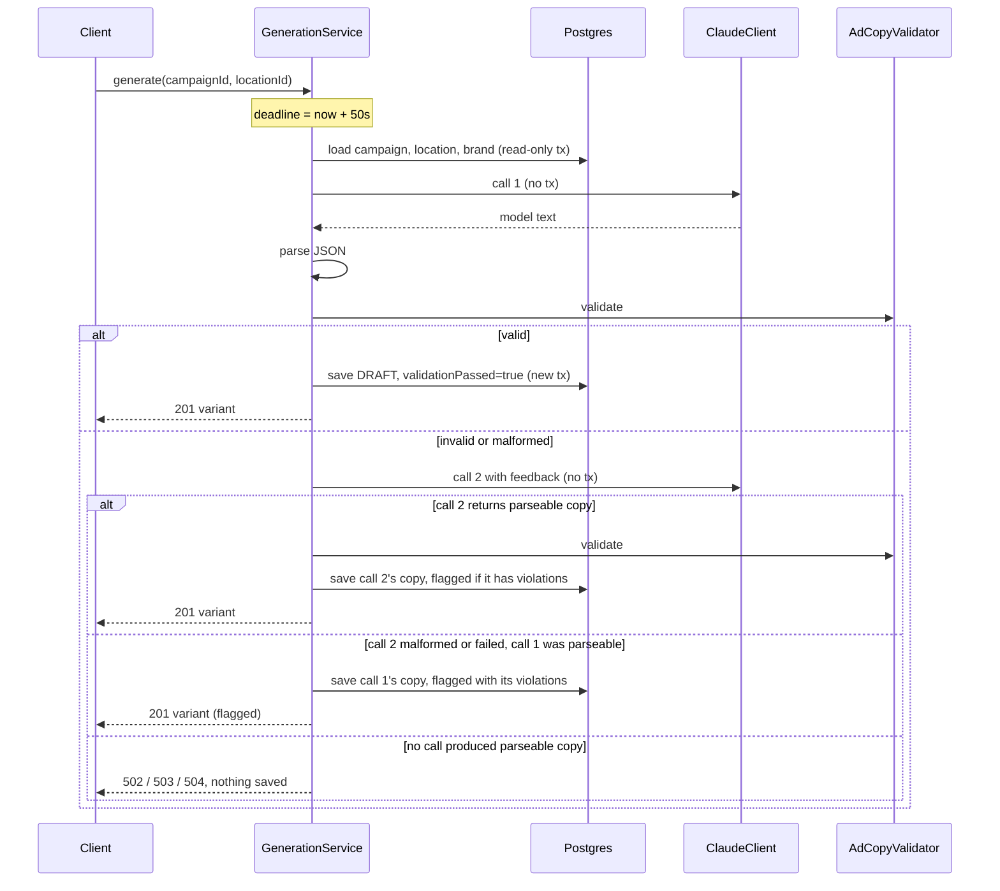
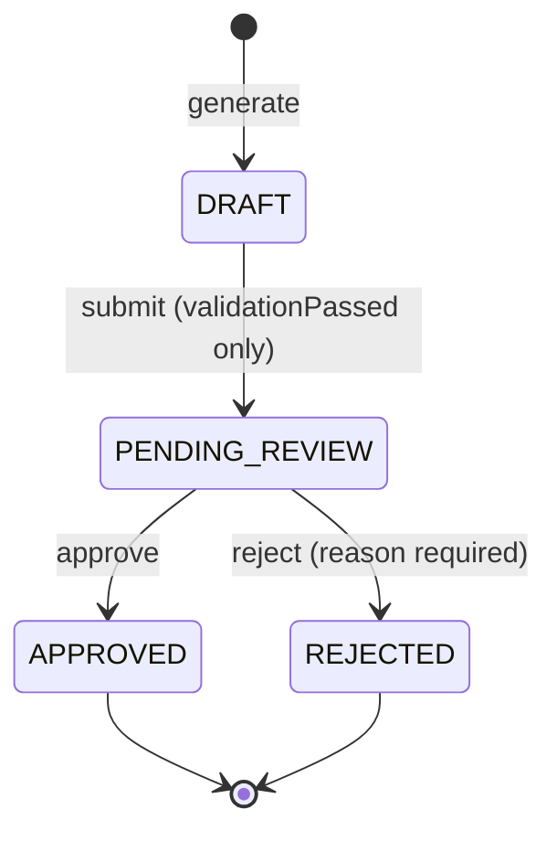

# Flows

This is the behavioral spec. Code must match it; if behavior changes, this file changes in the same commit.

## Generate flow

`POST /campaigns/{campaignId}/generate` with body `{ "locationId": 42 }`



### Steps

1. **Load** campaign, location, and brand in a read-only transaction (`GenerationInputLoader`). Missing campaign or location → 404. Location belongs to a different brand than the campaign → 422. The request's deadline (default 50s, see Latency budget) starts before this step.
2. **Prompt.** System prompt: brand voice guidelines, banned words, exact output counts, character limits, the no-exclamation rule for headlines, and "respond with JSON only". User prompt: location name, city, region, local offer, campaign theme.
3. **Call Claude** outside any transaction, with the request's deadline. Retries per the policy below happen inside `ClaudeClient` and don't count as regeneration attempts.
4. **Parse** into `AdCopy(headlines, descriptions)`. Strip one markdown fence around the JSON, trim entries, ignore extra keys. Anything else is malformed: surrounding prose, missing or null keys, non-arrays, non-string items, and any stop reason other than `end_turn` (`max_tokens` means the JSON was probably cut off). Counts and blank entries are left to the validator.
5. **Validate** with `AdCopyValidator`.
6. **Regenerate at most once** if step 4 or 5 failed. The second prompt includes the previous output and either every violation message, one per line, or the single line `Your previous response was not valid JSON: <parser detail>`.
7. **Save** in its own transaction (`VariantService.saveGenerated`). The rule (ADR-030): **if any call produced parseable copy, save the copy from the last call that did**, as `DRAFT`, with `validationPassed=true` and `violations=[]` if it has no violations, otherwise `validationPassed=false` and all of that call's violations (flagged; can never be submitted). Only when no call produced parseable copy does the request fail, and nothing is saved:

   | Call 1 | Call 2 | Saved | `generationAttempts` | Response |
   |---|---|---|---|---|
   | valid | not made | call 1 | 1 | 201 |
   | invalid or malformed | valid or invalid | call 2 | 2 | 201 |
   | invalid | malformed | call 1, flagged | 2 | 201 |
   | invalid | failed (timeout, deadline, 429/5xx, rejected) | call 1, flagged | 1 | 201 |
   | malformed | malformed | nothing | – | 502 |
   | malformed | failed | nothing | – | 504 / 503 / 502, per the failure |
   | failed | not made | nothing | – | 504 / 503 / 502, per the failure |

8. `generationAttempts` counts the model calls that returned a response (1 or 2). `model` records the model ID from the response of the call whose copy was saved (the configured model if the response didn't name one).

Maximum model calls per request: 2 (not counting transport retries).

### Expected model output

```json
{
  "headlines": ["...", "...", "...", "...", "..."],
  "descriptions": ["...", "..."]
}
```

### Response

```json
{
  "id": 7,
  "campaignId": 3,
  "locationId": 42,
  "status": "DRAFT",
  "validationPassed": false,
  "violations": ["HEADLINE_TOO_LONG: headlines[2] is 34 characters (max 30): \"...\""],
  "headlines": ["..."],
  "descriptions": ["..."],
  "generationAttempts": 2,
  "model": "claude-haiku-5-5",
  "createdAt": "2026-11-01T14:03:11Z"
}
```

## Reading variants

- `GET /variants/{id}` returns one variant in the response shape above; unknown ID → 404.
- `GET /campaigns/{campaignId}/variants` lists the campaign's variants, flagged ones included, oldest first. Optional `?status=` takes the exact status names (`DRAFT`, `PENDING_REVIEW`, `APPROVED`, `REJECTED`); any other value, lowercase included, → 400. Unknown campaign → 404, never an empty list (ADR-018).

## Validation rules

| Rule | Applies to | Detail | Message |
|---|---|---|---|
| `WRONG_COUNT` | both | exactly 5 headlines, 2 descriptions (configurable within Google's limits) | `WRONG_COUNT: headlines has 4 entries (expected 5)` |
| `BLANK` | both | empty after trim | `BLANK: descriptions[1] is blank` |
| `HEADLINE_TOO_LONG` | headlines | more than 30 Unicode code points | `HEADLINE_TOO_LONG: headlines[2] is 34 characters (max 30): "..."` |
| `DESCRIPTION_TOO_LONG` | descriptions | more than 90 Unicode code points | `DESCRIPTION_TOO_LONG: descriptions[0] is 95 characters (max 90): "..."` |
| `EXCLAMATION_IN_HEADLINE` | headlines | contains `!` | `EXCLAMATION_IN_HEADLINE: headlines[0] contains "!": "..."` |
| `BANNED_WORD` | both | brand banned word or phrase, case-insensitive, whole word | `BANNED_WORD: headlines[3] contains banned word "best in town": "..."` |
| `DUPLICATE` | both | same text twice within the list, case-insensitive, trimmed | `DUPLICATE: headlines[4] repeats headlines[1]: "..."` |

- Character counts use code points, not `String.length()`, so an emoji counts as one character. Counts and limits come from `AdCopyRules` (ADR-024), the same values the prompt states.
- **Whole word** (ADR-028): a banned word or phrase matches only where it doesn't touch a letter or digit on either side. "cheap" doesn't match "cheapest" or "overcheap", but does match "Cheap", "cheap-looking" and "cheap." Whitespace inside a phrase matches any run of whitespace, so "best in town" matches "Best In Town" and "best  in town" but not "best inn town". Letter case is compared with Unicode rules ("café" matches "CAFÉ"), and other characters match literally ("50% off"). Each banned word is reported once per entry.
- **Duplicates** compare entries after trimming and lowercasing; each repeat is reported against the first occurrence. Headlines and descriptions are checked separately.
- A blank entry gets only `BLANK`. Every other entry is checked against every rule, even when the count is wrong, so the regeneration prompt carries complete feedback.
- **Order:** headlines, then descriptions. Within each list the count comes first, then the entries by index, then the rules in the order of this table.

## Approval flow



| Action | Endpoint | Allowed from |
|---|---|---|
| submit | `POST /variants/{id}/submit` | `DRAFT` with `validationPassed=true` |
| approve | `POST /variants/{id}/approve` | `PENDING_REVIEW` |
| reject | `POST /variants/{id}/reject` `{ "reason": "..." }` | `PENDING_REVIEW` |

Anything else is 409. `APPROVED` and `REJECTED` are terminal; a rejected location gets a fresh variant by generating again. `AdVariant` carries a `@Version`, so concurrent approve and reject resolve to one winner and one 409.

## Claude retry policy

| Upstream result | Retry? | After the last attempt |
|---|---|---|
| 2xx with a valid Messages response | no, returned | n/a |
| 2xx whose body isn't a Messages response (not JSON, no `content` array, a text block without a string) | yes | `ClaudeUnavailableException` |
| 429 | yes | `ClaudeUnavailableException` |
| any 5xx, including 529 | yes | `ClaudeUnavailableException` |
| connect or read timeout | yes | `ClaudeTimeoutException` |
| connection refused or reset | yes | `ClaudeUnavailableException` |
| 400, 401, 403, 404, any other 4xx | no, fail immediately | `ClaudeRequestException` |
| no API key configured | no HTTP call at all | `ClaudeRequestException` |
| the caller's deadline has passed, or the next retry delay would end after it | no (stops at once) | `ClaudeTimeoutException` |

Max 3 attempts total. The last attempt decides the exception type. Backoff: 500ms, then 1s, each with up to 25% random jitter. If a retryable response (429 or 5xx) carries `retry-after` in whole seconds, that delay is used instead, capped at 10s and without jitter; any other `retry-after` value (an HTTP date, a fraction, garbage) is ignored in favor of the normal backoff. Defaults: connect timeout 3s, read timeout 20s. All configurable. The read timeout bounds a whole attempt, connect included.

**Deadline.** A caller can pass a deadline for the whole call, retries included (the generate flow does, see Latency budget). Each attempt's read timeout is then the configured one or the time left, whichever is shorter. No attempt starts once the deadline has passed, and a retry delay that would end at or after it isn't waited out: the call stops with `ClaudeTimeoutException` (504), whatever the last failure was.

**Envelope vs. model output.** Retries are about the transport only. A valid Messages response whose text isn't valid ad copy is returned after one request; `AdCopyParser` rejects it and the generate flow's single regeneration (step 6) handles it. A `max_tokens` or `refusal` stop reason is treated the same way: the call succeeded, the output is unusable.

## Error mapping

All errors are `ProblemDetail` (RFC 9457). Internal details and stack traces are never returned. The 502/503/504 responses carry fixed details ("The AI provider is unavailable. Try again later." and so on); Claude's error text and request IDs go only to the log. When an earlier call did produce parseable copy, a Claude failure doesn't reach the client at all: the variant is saved flagged and returned with 201 (step 7).

| Situation | Status |
|---|---|
| Bean validation failure | 400, with per-field errors: `"errors": [{"field": "bannedWords[1]", "message": "must not be blank"}]`, sorted by field |
| Unreadable JSON request body | 400 |
| Missing request parameter, non-numeric path ID, unknown `status` value | 400 |
| Unknown path | 404 |
| Wrong HTTP method / unsupported content type | 405 / 415 |
| Brand, location, campaign, or variant not found (including the parent brand of a nested create or list) | 404 |
| Location doesn't belong to the campaign's brand | 422, detail names the location and campaign |
| Duplicate brand name, ignoring case (`uq_brand_name_lower`) | 409 |
| Illegal status transition, or submitting a flagged variant | 409 |
| Concurrent modification (`@Version`) | 409 |
| Model output malformed on both attempts (no call produced parseable copy) | 502 |
| Claude rejected our request (non-retryable 4xx, e.g. bad key), or no API key is configured, and no call produced parseable copy | 502, logged at ERROR |
| Claude 429 or 5xx after all retries, and no call produced parseable copy | 503 |
| Claude timed out after all retries, or the 50s request deadline ran out, and no call produced parseable copy | 504 |
| Anything unexpected, including an unmapped database integrity violation | 500, generic message, logged at ERROR |

## Latency budget

A generate request gets a deadline of 50s from its start (`franchiseads.generation.deadline`), shared by both model calls and all their retries (ADR-027). `ClaudeClient` clamps each attempt's read timeout to the time left and stops with `ClaudeTimeoutException` instead of starting an attempt or a retry delay that can't finish in time.

- **Before (M2 settings):** an attempt could take the full 30s read timeout (connect included), and a retry delay up to the 10s `retry-after` cap. One call: 3 × 30 + 2 × 10 = 110s. The regeneration only starts after call 1 returns, so in the worst case call 1 succeeds on its third slow attempt with unusable output and call 2 fails the same way: 220s.
- **Now:** read timeout 20s, deadline 50s. Every Claude call ends by request start + 50s, whatever upstream does; loading and saving add milliseconds. Inside the budget, call 1 fits at most two full 20s attempts and a clamped third, and the regeneration gets whatever is left. If the deadline cuts the regeneration short after a parseable call 1, call 1's copy is saved flagged (step 7).

The 50s bound keeps responses inside the 60s idle timeout of a default AWS load balancer (M6).

## Transaction boundaries

The Claude call can take seconds. Holding a database transaction (and a pooled connection) across it would exhaust the pool under load. So generation runs in three phases: a read-only transaction to load inputs, the Claude calls with no transaction, then a short transaction to save. `GenerationService.generate` itself is not `@Transactional`. The two transactional steps live in other beans (`GenerationInputLoader.load`, `VariantService.saveGenerated`) and are called through their Spring proxies; a `@Transactional` method called on `this` would silently run without a transaction (ADR-029). `GenerationTransactionBoundaryTests` checks that no transaction is active inside each Claude call.
