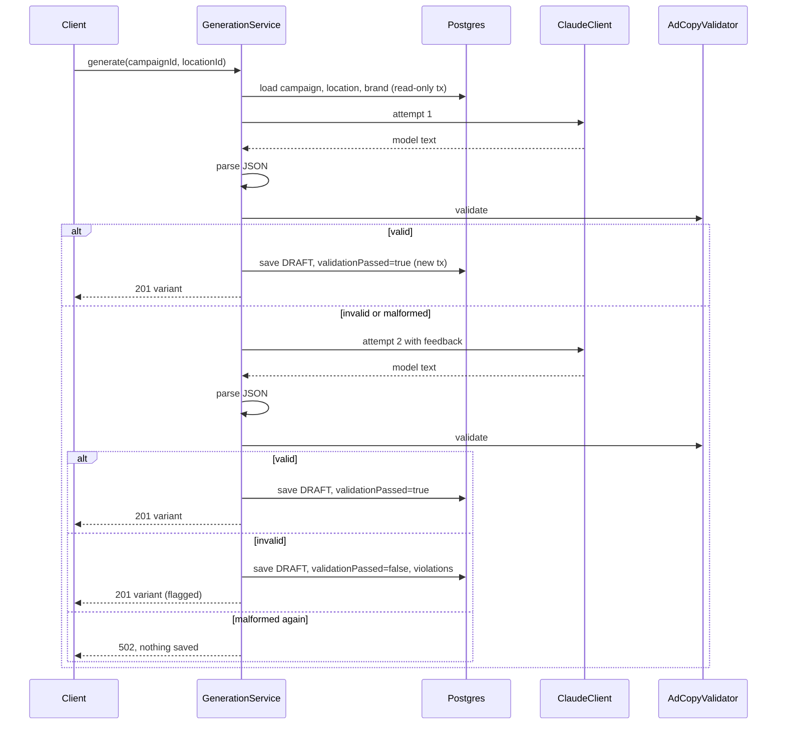
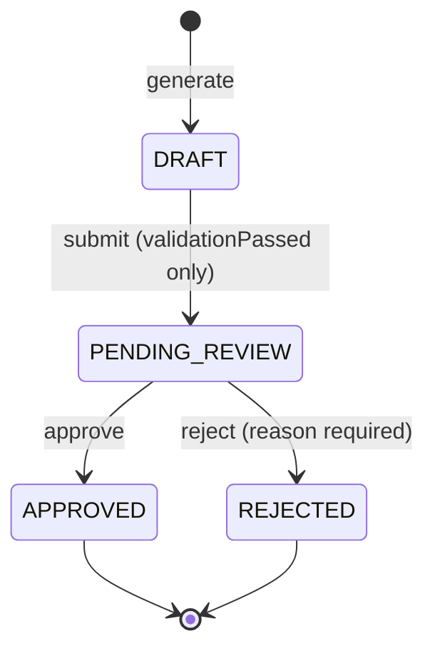

# Flows

This is the behavioral spec. Code must match it; if behavior changes, this file changes in the same commit.

## Generate flow

`POST /campaigns/{campaignId}/generate` with body `{ "locationId": 42 }`



### Steps

1. **Load** campaign, location, and brand in a read-only transaction. Missing campaign or location → 404. Location belongs to a different brand than the campaign → 422.
2. **Prompt.** System prompt: brand voice guidelines, banned words, exact output counts, character limits, the no-exclamation rule for headlines, and "respond with JSON only". User prompt: location name, city, region, local offer, campaign theme.
3. **Call Claude** outside any transaction. Retries per the policy below happen inside `ClaudeClient` and don't count as regeneration attempts.
4. **Parse** into `AdCopy(headlines, descriptions)`. Strip markdown fences, trim entries. Anything else unparseable is malformed.
5. **Validate** with `AdCopyValidator`.
6. **Regenerate at most once** if step 4 or 5 failed. The second prompt includes the previous output and either the violation list or "your previous response was not valid JSON".
7. **Save** in its own transaction:
   - valid: `DRAFT`, `validationPassed=true`, `violations=[]`
   - still invalid: `DRAFT`, `validationPassed=false`, all violations from the final attempt (flagged; can never be submitted)
   - malformed twice: nothing saved, 502
8. `generationAttempts` records 1 or 2. `model` records the model ID used.

Maximum model calls per request: 2 (not counting transport retries).

### Expected model output

```json
{
  "headlines": ["...", "...", "...", "...", "..."],
  "descriptions": ["...", "..."]
}
```

### Response

```json
{
  "id": 7,
  "campaignId": 3,
  "locationId": 42,
  "status": "DRAFT",
  "validationPassed": false,
  "violations": ["HEADLINE_TOO_LONG: headlines[2] is 34 characters (max 30): \"...\""],
  "headlines": ["..."],
  "descriptions": ["..."],
  "generationAttempts": 2,
  "model": "claude-haiku-5-5",
  "createdAt": "2026-11-01T14:03:11Z"
}
```

## Validation rules

| Rule | Applies to | Detail |
|---|---|---|
| `WRONG_COUNT` | both | exactly 5 headlines, 2 descriptions (configurable within Google's limits) |
| `HEADLINE_TOO_LONG` | headlines | more than 30 Unicode code points |
| `DESCRIPTION_TOO_LONG` | descriptions | more than 90 Unicode code points |
| `BLANK` | both | empty after trim |
| `EXCLAMATION_IN_HEADLINE` | headlines | contains `!` |
| `BANNED_WORD` | both | brand banned word or phrase, case-insensitive, whole word |
| `DUPLICATE` | both | same text twice within the list, case-insensitive, trimmed |

Character counts use code points, not `String.length()`, so an emoji counts as one character.

## Approval flow



| Action | Endpoint | Allowed from |
|---|---|---|
| submit | `POST /variants/{id}/submit` | `DRAFT` with `validationPassed=true` |
| approve | `POST /variants/{id}/approve` | `PENDING_REVIEW` |
| reject | `POST /variants/{id}/reject` `{ "reason": "..." }` | `PENDING_REVIEW` |

Anything else is 409. `APPROVED` and `REJECTED` are terminal; a rejected location gets a fresh variant by generating again. `AdVariant` carries a `@Version`, so concurrent approve and reject resolve to one winner and one 409.

## Claude retry policy

| Upstream result | Retry? |
|---|---|
| 200 | no |
| 429 | yes, honor `retry-after` (capped at 10s) |
| 500, 502, 503, 504, 529 | yes |
| connect or read timeout | yes |
| 400, 401, 403, 404, other 4xx | no, fail immediately |

Max 3 attempts total. Backoff: 500ms, then 1s, each with up to 25% random jitter. Defaults: connect timeout 3s, read timeout 30s. All configurable.

## Error mapping

All errors are `ProblemDetail` (RFC 9457). Internal details and stack traces are never returned.

| Situation | Status |
|---|---|
| Bean validation failure | 400, with per-field errors: `"errors": [{"field": "bannedWords[1]", "message": "must not be blank"}]`, sorted by field |
| Unreadable JSON request body | 400 |
| Missing request parameter, non-numeric path ID | 400 |
| Unknown path | 404 |
| Wrong HTTP method / unsupported content type | 405 / 415 |
| Brand, location, campaign, or variant not found (including the parent brand of a nested create or list) | 404 |
| Location doesn't belong to the campaign's brand | 422 |
| Duplicate brand name, ignoring case (`uq_brand_name_lower`) | 409 |
| Illegal status transition, or submitting a flagged variant | 409 |
| Concurrent modification (`@Version`) | 409 |
| Model output malformed on both attempts | 502 |
| Claude rejected our request (non-retryable 4xx, e.g. bad key) | 502, logged at ERROR |
| Claude 429 or 5xx after all retries | 503 |
| Claude timed out after all retries | 504 |
| Anything unexpected, including an unmapped database integrity violation | 500, generic message, logged at ERROR |

## Transaction boundaries

The Claude call can take seconds. Holding a database transaction (and a pooled connection) across it would exhaust the pool under load. So generation runs in three phases: a read-only transaction to load inputs, the Claude calls with no transaction, then a short transaction to save. `GenerationService.generate` itself is not `@Transactional`.
